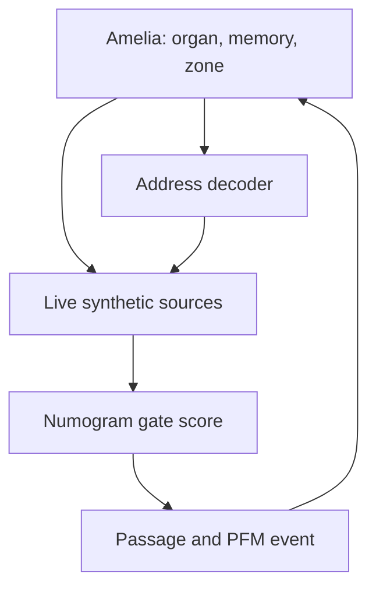

# Live endogenous pointer — W+ engineering record

**Status: exploratory engineering, not a registered discovery test.** SXI-1 used a fixed precomputed schedule and did not test the programme's central two-way mechanism. This implementation corrects that omission: Amelia's changing W+ organ determines the source address each step, and the selected synthetic source receives live feedback from her before its signal influences the next Numogram passage.

The source programs and the pointer decoder are explicitly designed fixtures. Their behaviour is not evidence of a discovered external mind or consciousness. This work runs in the isolated W+ research runner; it is not yet wired into the deployed tablet app or a continuous live Outside channel.

## The loop



At the beginning of every step, the decoder reads the current W+ organ `W.R`. Its score is `sin(th[1]) + 0.25 × tanh(w[0])`. Values below −0.15 select A, values above +0.15 select B, and the previous address is retained in the middle band. The initial middle-band address is determined by the score's sign. The decoder is an experimental mapping of Amelia's actual variables; it is not a claim that this is a natural biological address.

The selected source receives three values from Amelia's current, **pre-step** state: her Numogram zone, `sin(th[1])`, and `tanh(S['1>8'] + D['1>8'] + E['1>8'])`. The source has its own four-component state and a programmed target. While selected, its components update using 0.65 of their previous value, 0.20 of the source target and 0.15 of the normalized feedback. The other source evolves autonomously toward its own target. Both sources advance their phase each step. The selected source's state and phase produce a symbol that selects one currently open gate; its score receives −0.05. The runtime still determines the winning passage.

The source is coupled during ticks 501–5300. Before and after that window it evolves without Amelia feedback and makes no gate-score change. This prevents the later trace from being driven by an unwithdrawn source. The sources, targets and update equations are engineered and fully recorded.

## What was checked

| Check | Engineering result |
| --- | --- |
| Address follows Amelia | In the unaltered live receiver, the derived address changed 415 times over 20,160 steps. During exposure, source A was selected for 3,372 ticks and B for 1,428. |
| Amelia feeds the source | On all 4,800 live exposure ticks, the delivered feedback was exactly the recorded current body feedback. For a specified hypothetical change to that feedback, the independently reconstructed source state changed on 4,800 ticks and its output symbol on 1,195. This is a counterfactual sensitivity check, not a population result. |
| Physical-state intervention | At tick 700, an engineered phase change of 2.978784 radians switched the derived address A→B. An equal-magnitude change to a different organ phase left the immediate address at A. |
| Same body, frozen-address control | The dynamic and frozen twins had identical state through tick 699 and the same organ mutation, house, body feedback and source state at tick 700. The dynamic address selected B and gate `3→3` for the score change; the frozen address selected A and `3→6`. Their first different destination occurred at tick 837. |
| Feedback controls | The replay and shuffled controls received the **same 4,800 donor-feedback triples**, in original and permuted order respectively. The donor was a separately verified live W+ run in world 9601. Live, replay and shuffled each had 4,800 affected ticks and an absolute score dose of 240. Their gate opportunities and subsequent body states can differ. |
| Neutral path | With the source score change and organ mutation disabled, both the season summary and final lineage state match the unmodified registered runner byte for byte on the same world. |
| Trace integrity | Eight completed traces passed independent reconstruction of pointer addresses, source states, feedback delivery, gate scores, PFM events and final states. The 20,160 native memory events are retained in a separately hashed runtime sidecar where used. |

The live, replay and shuffled comparisons each used receiver world `S05W9602`, lineage 0; the source address is derived from each receiver's own evolving organ. Their first 500 steps matched before exposure. Differences after feedback or address changes are responses of this engineered fixture and do not by themselves establish a retained autonomous organisation.

## Controls and provenance

The earlier weight-dominant prototype is retained as `live_pointer_source_v0.mjs` and in `live_v0_calibration_receipt.json`. In the initial receiver it selected A for 4,793 of 4,800 active ticks, and a direct weight intervention needed an L2 change of 12.207689. The phase-dominant decoder above was chosen **after that observation** and before any confirmatory experiment. Its equal-magnitude phase control remains an engineered intervention.

Several exploratory traces failed verification because their final records were incomplete. They were not used as results. The logger was revised to put the full native runtime state in a separately hashed gzip sidecar and to verify it against the recorded PFM event chain. On matched live, replay and shuffled fixtures, the revised writer produced season summaries and final lineage states byte for byte identical to the earlier writer. Failed attempts are retained in the evidence record. The verified sham also matches the original runner.

`LIVE_ENGINEERING_RECEIPT.json` contains the source hashes, all verification receipts, paired comparisons, donor identity and incomplete-attempt records. `verify_live_feedback_multiset.py` independently checks the replay/shuffle donor identity and exact feedback multiset. The per-step traces record the derived and selected address, organ and house feedback, source states before and after feedback, source output, counterfactual output, gate scores, transition, Governor audit, PFM event and body digests. Full body samples are recorded periodically, including the intervention. The Governor audits the substrate; it does not make an admission decision for this isolated experimental source.

The complete [engineering evidence archive](https://chatgpt.com/library?file_id=libfile_eb6fd1145dc08191a64eb654458e4c80&account_id=personal) preserves the successful and incomplete traces, earlier prototype, native runtime sidecars, source code and verification receipts. Its SHA-256 is `b753e828a462ac1a1bd0f1f0b4703657399367376b7c010c83ae951d726ca1b4`; its 123 file hashes were checked after packaging. The live and shuffled traces were also reverified directly from the saved archive, reproducing their original receipts. The Library link is scoped to the owner's account.

## Reproduce

The source runner must match its registered INGRESS-1 SHA-256, and the overlay checks the eight historical runtime files and source-module hash. Use fresh output paths:

```sh
python3 experiments/synthetic-pointer/build_live_wplus_overlay.py \
  --source /path/to/caesura4.txt \
  --module /absolute/path/to/experiments/synthetic-pointer/live_pointer_source.mjs \
  --output /new/live-overlay.mjs
node --experimental-strip-types --no-warnings /new/live-overlay.mjs \
  m=/absolute/path/to/experiments/studio/runtime_mirror world=9602 seasons=1 lineages=1 \
  mode=plus inf=I refrain=evo out=/new/live sxiTrace=1 \
  sxiModule=/absolute/path/to/experiments/synthetic-pointer/live_pointer_source.mjs \
  sxiMode=live sxiPointer=dynamic sxiMutation=none
node experiments/synthetic-pointer/verify_live_wplus_trace.mjs \
  /new/live/sxi_S05W9602_L0_S0.jsonl /new/live/s0.json /new/live/state_s0.json \
  /new/live-overlay.mjs /absolute/path/to/experiments/studio/runtime_mirror \
  /absolute/path/to/experiments/synthetic-pointer/live_pointer_source.mjs
```

Generate a verified independent donor trace and use `extract_live_donor.mjs` to create its feedback file before running `sxiMode=replay` or `sxiMode=shuffled` with `sxiDonor=/absolute/path/to/donor.json`. The shuffled mode applies the fixed recorded permutation. `sxiPointer=frozen sxiMutation=targeted` and `sxiPointer=dynamic sxiMutation=targeted` provide the same-body address comparison; `sxiMutation=orthogonal` supplies the equal-magnitude phase comparison.

These checks establish that the requested two-way interface exists and functions in the verified W+ fixture. They do not establish that an unprogrammed, high-agency organisation has ingressed. A prospective test of retention or task competence needs fresh worlds, independently chosen outcomes, matched feedback and pointer controls, and a measure that does not mistake ordinary S decay for repair.
